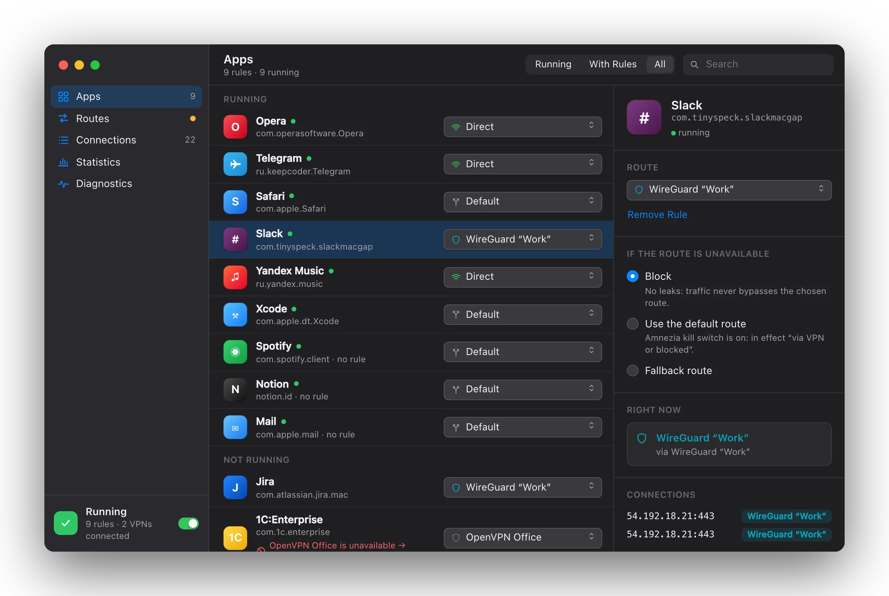
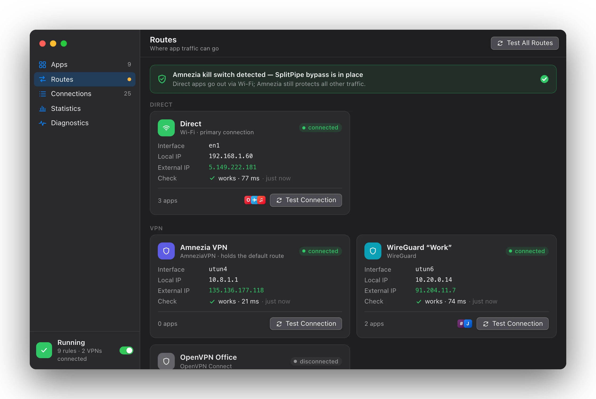
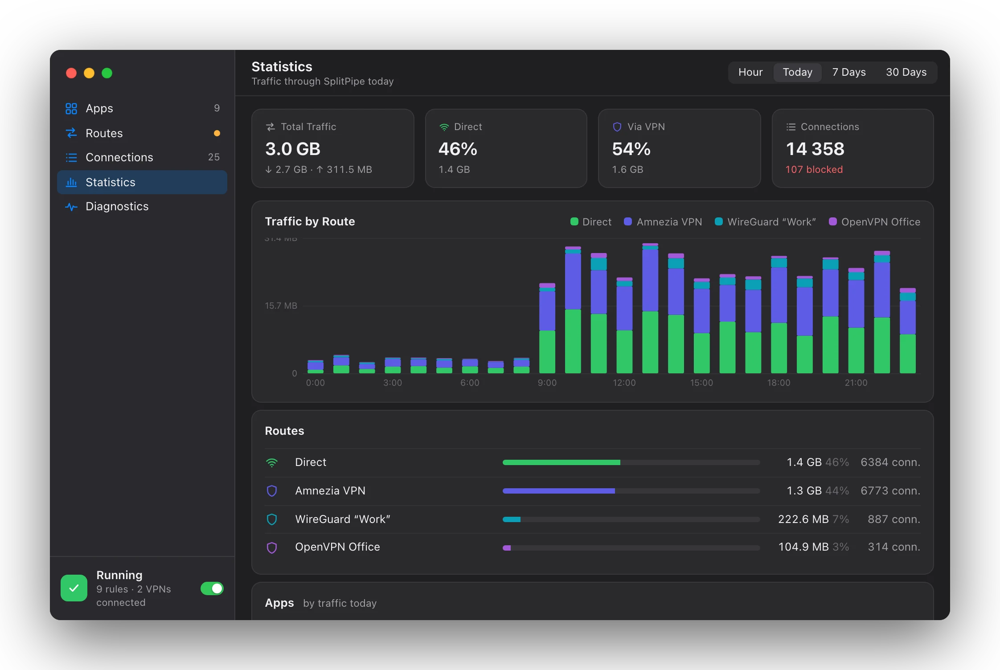
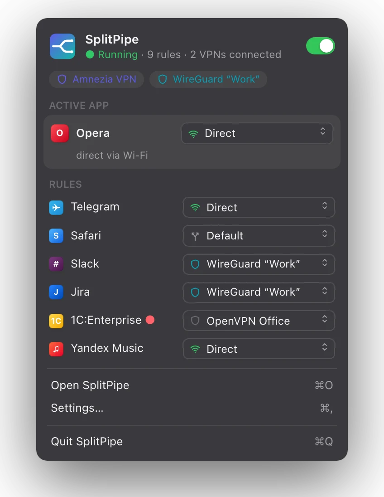

# SplitPipe

Per-app traffic routing for macOS. For every app you pick where its traffic goes: through a VPN, directly through
Wi-Fi/Ethernet, or nowhere (blocked).

The main scenario: a VPN (e.g. AmneziaVPN) holds the default route and a kill switch, while selected apps go around it
directly — without turning the VPN off and without split-tunneling support in the VPN client itself.



## Features

- Route per app: **Default** (system route), **Direct**, any connected **VPN**, or **Block**, with a fallback for when
  the route is unavailable.
- Rules for command-line programs by binary path; WebKit and XPC helpers follow their parent app.
- Several VPNs at once (AmneziaVPN, WireGuard, OpenVPN, Outline and other `utun` interfaces), recognized by role, so
  rules survive reconnects.
- Bypass of a VPN client's pf kill switch for "Direct" apps.
- Route checks with external IP and country over TCP and UDP, live connections feed, traffic statistics, diagnostics
  with one-click fixes, event history.
- Temporary routes, IP-list (CIDR) rules, rules for new apps, notifications.
- Menu bar extra, widget and Control Center toggle, Shortcuts actions, `splitpipe://` URL scheme, global hotkeys.
- English and Russian UI, following the system language.

| Routes | Statistics | Menu bar |
| --- | --- | --- |
|  |  |  |

## Components

| Component | Path | Role |
| --- | --- | --- |
| App | `SplitPipe/` | SwiftUI app: rules, routes, UI, settings, notifications. Owns all state and downloads. |
| Proxy extension | `SplitPipeProxy/` | `NETransparentProxyProvider` system extension (root, sandboxed): intercepts TCP/UDP flows and relays them by rule through the chosen interface. Counts statistics. |
| Helper | `SplitPipeHelper/` | Root launch daemon (`SMAppService.daemon`): pf rule and scoped routes for the kill switch bypass, reset of connections opened before SplitPipe. |
| Widgets | `Widgets/` | WidgetKit extension: status widget and Control Center toggle. |
| Shared | `Shared/` | Code used by all of the above: network state, VPN detection, routing socket monitor, messages, events. |
| Tests | `Tests/` | Unit tests for the pure logic. |

More in [docs/architecture.md](docs/architecture.md).

## Building

Requirements: macOS 26+, Xcode 26, [XcodeGen](https://github.com/yonaskolb/XcodeGen), an Apple developer team (system
extensions must be signed). Set your `DEVELOPMENT_TEAM` in `project.yml`.

```bash
make build    # generate the Xcode project and build
make install  # build and copy to /Applications (system extensions only run from there)
make run      # install and launch
make test     # unit tests
make logs     # stream logs
```

On first launch, the onboarding asks to approve the network extension, the proxy configuration and the background
helper in System Settings.

## Documentation

- [Architecture](docs/architecture.md)
- [Development notes and troubleshooting](docs/development.md)
- [System notes](docs/system-notes.md) — macOS and AmneziaVPN behavior SplitPipe relies on
- [Known limitations](docs/known-limitations.md)
- [Plans](docs/plans/PLANS.md)
